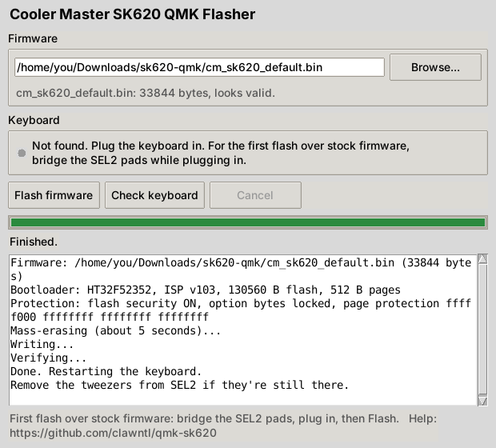

# QMK for the Cooler Master SK620

QMK firmware for the **Cooler Master SK620** 60% low-profile keyboard (UK ISO), plus everything learned while porting it: the full pin map, the format of Cooler Master's firmware updaters, and the tools used to read the hardware layout out of the stock firmware.

The pins were never probed by hand. They were read out of Cooler Master's own SK620 firmware by decoding the official updater and running the firmware in an emulator (see [docs/reverse-engineering.md](docs/reverse-engineering.md)).

## Status

| Feature | Status |
| --- | --- |
| All 65 keys (UK ISO) | Working, confirmed on hardware |
| Fn layer from the keycap legends | Working |
| Per-key RGB (MBIA043 driver) | Lights and animates, confirmed on hardware |
| LED-to-key mapping (65 LEDs, one per key) | Mapped on hardware ([docs/led-mapping.md](docs/led-mapping.md)) |
| RGB effects that react to key presses (splash, reactive, typing heatmap) | Working, confirmed on hardware |
| Caps Lock / Windows-key lock indicators (on the key's own LED) | Built; not yet tried on hardware |
| Settings saved across unplugs (SPI flash) | Working, confirmed on hardware |
| Change keys and lighting from the PC (VIA) | Built (`cm_sk620_via.bin`); not yet tried on hardware |
| ANSI (US) SK620 | Matrix is the same; needs an ANSI layout and keymap |
| SK622 (Bluetooth model) | Not supported |
| One-step flasher with GUI, no dependencies | Working on Linux (CachyOS), including automatic bootloader entry; Windows build not yet tried on hardware |
| Going back to stock firmware | Possible from Cooler Master's updater, untested (see [docs/stock-firmware.md](docs/stock-firmware.md)) |

## Hardware at a glance

| Part | What |
| --- | --- |
| MCU | Holtek HT32F52352 (Cortex-M0+, 128 KiB flash, 16 KiB RAM), printed "HT50F52352" |
| LED drivers | 3 x Macroblock MBIA043GP (one per colour), 8 LED rows |
| Storage | 512 KiB SPI NOR flash (GD25Q40 class) |
| Bootloader | Holtek ROM ISP over USB, entered by bridging the SEL2 pads |
| Key matrix | 9 rows x 8 columns, COL2ROW |

The full pin map is in [docs/hardware.md](docs/hardware.md).

## Quick start

Download the latest [release](https://github.com/clawntl/qmk-sk620/releases). It contains the firmware, `sk620_flash.exe` for Windows and `sk620_flash.py` for Linux; no drivers or other installs are needed.

- **Windows:** double-click `sk620_flash.exe` and click **Flash firmware**.
- **Linux:** run `python3 sk620_flash.py` and click **Flash firmware**. It offers to set up USB permissions the first time. If no window appears, install Tk (`sudo pacman -S --needed tk`), or use `--cli`.



For the **first flash** over Cooler Master's firmware, open the case, bridge the **SEL2** pads with tweezers and plug in before starting the flasher. It will ask you to type `ERASE`. After that, updates need nothing but the flasher: it puts the keyboard into bootloader mode by itself.

> [!WARNING]
> The first flash permanently erases Cooler Master's firmware and its updater. The chip is read-protected, so it can't be backed up first. [docs/stock-firmware.md](docs/stock-firmware.md) describes how to rebuild a bootable stock image from Cooler Master's official updater. That restore image is untested.

## Changing settings from the PC

Flash `cm_sk620_via.bin` instead of the default firmware, then open [usevia.app](https://usevia.app) in Chrome or Edge (Windows or Linux, nothing to install) to remap keys on 4 layers, record macros, and set the lighting effect, brightness, speed and colour. See [docs/configuring.md](docs/configuring.md).

## Building

Everything needed is in this repository: official QMK as a pinned submodule, the HT32 and MBIA043 support as patches in [`patches/qmk`](patches/qmk/README.md), and a build script. Only the ARM compiler comes from your distribution:

```sh
sudo pacman -Syu && sudo pacman -S --needed git make python arm-none-eabi-gcc arm-none-eabi-newlib
git clone --recurse-submodules https://github.com/clawntl/qmk-sk620
cd qmk-sk620
./build.sh        # out/cm_sk620_default.bin   (./build.sh via -> out/cm_sk620_via.bin)
```

`build.sh` writes only inside the repository and uses its own Python venv. Details, and flashing with `ht32-dfu-tool` instead, are in [docs/flashing.md](docs/flashing.md).

## Default keymap

Layer 0 is the stock UK layout, taken directly from Cooler Master's firmware. The Fn layer follows the keycap legends:

| Fn + | Action | Fn + | Action |
| --- | --- | --- | --- |
| Esc | ` (with Shift: ¬) | J / K / L | Play-pause / previous / next track |
| 1 … = | F1 … F12 | , / . / / | Volume down / up / mute |
| Backspace | Eject | Right Shift | Windows-key lock |
| U / I / O | Print Screen / Scroll Lock / Pause | Tab | RGB on/off |
| P | Insert | ↑ / ↓ | RGB brightness up / down |
| [ / ] | Home / Page Up | ← / → | Previous / next RGB effect |
| ; / ' | End / Page Down | Q W E / A S D | Hue, saturation, speed up / down |
| B | Bootloader | | |

With RGB on, Caps Lock lights the Caps Lock key white and the Windows-key lock lights the Windows key red, on top of the current effect.

## Repository layout

```
build.sh                   builds the firmware into out/ from the files below
qmk_firmware/              official QMK, git submodule pinned to a tested commit (not modified)
patches/qmk/               HT32 MCU and MBIA043 LED driver support, applied by build.sh
qmk/keyboards/cm/sk620/    the SK620 keyboard definition and keymaps (default, via, ledmap)
via/sk620_iso.json         VIA definition, to load in usevia.app
docs/hardware.md           pin map, matrix, LED driver wiring, protection bits
docs/flashing.md           flashing, building, recovery
docs/configuring.md        changing keys and lighting from the PC with VIA
docs/led-mapping.md        finding which LED is under which key (ledmap keymap)
docs/stock-firmware.md     Cooler Master updater format, extracting and restoring stock firmware
docs/reverse-engineering.md how the pin map was read out of the stock firmware
tools/flash/               sk620_flash.py: dependency-free flasher (window + command line) for Windows and Linux, plus its tests
tools/via/                 generates the VIA definition from keyboard.json
tools/ledmap/              the LED map result and the script that applies it to keyboard.json and sk620.c
tools/cm_fw_extract.py     extract firmware images from a Cooler Master SK620 updater .exe
tools/analysis/            Unicorn-based emulator and the scripts that produced the pin map
tools/porting/             pin-finder firmware and log-to-QMK script for boards without stock firmware
```

## Credits

- **Hansem Ro (hansemro)** for HT32 support in QMK and ChibiOS and the MBIA043 driver (the two patches in `patches/qmk`), the MasterKeys ports this builds on, and `ht32-dfu-tool`.
- **ChaoticEnigma** and the pok3rtool project for documenting the Vortex/Cooler Master updater encoding and the CYKB firmware XOR key.
- **mateuszradomski/re-masterkeys** for the MasterKeys Pro S White reverse-engineering notes and schematic.

## Licence

GPL-2.0-or-later, matching QMK. This repository contains no Cooler Master code or firmware. The extractor works on an updater you download yourself.

This project is not affiliated with or endorsed by Cooler Master. Flashing third-party firmware may void your warranty.
