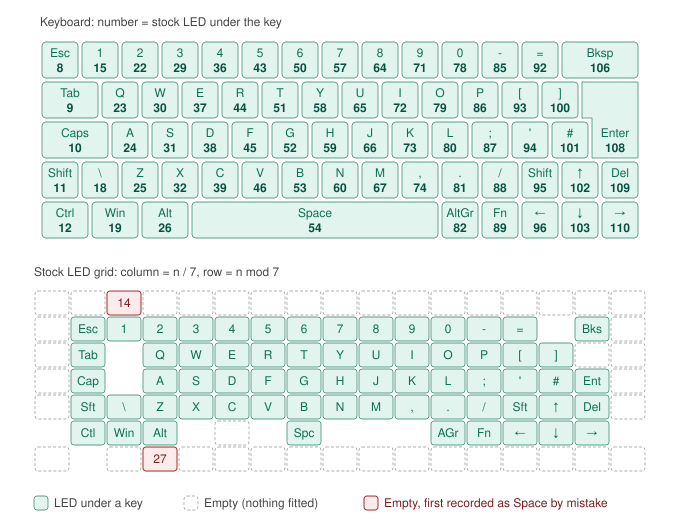

# Mapping which LED is under which key

Before mapping, the LED driver table copied from the stock firmware has 108 LED positions, but the SK620 has only 65 keys. QMK needs to know which LED sits under which key before effects can react to key presses or each key can have its own colour. `cm_sk620_ledmap.bin` is a throwaway firmware that finds this out with your help. It takes about 5 minutes.

## Before you start

- **Use your mouse.** While the mapper runs, the keyboard sends nothing to the PC.
- **Open a plain text editor** (Kate, gedit or KWrite on Linux, Notepad on Windows). Don't use a chat box, browser or terminal: the result is typed with Enter between lines, which would send or run it.
- Build it with `./build.sh ledmap`, or use `cm_sk620_ledmap.bin` from the release.

## Steps

1. **Flash it.** In `sk620_flash`, click **Browse...**, choose `cm_sk620_ledmap.bin` and click **Flash firmware**. The keyboard restarts with all LEDs off except **one white LED**.
2. **Tap the key under the white LED.** That key turns dim green and the next LED lights up white.
3. **No white LED anywhere?** That position has no LED fitted, which happens about 40 times. **Hold any key for about a second** and let go once the green keys blink white: that blink confirms the skip. If there's still nothing lit, hold again. One hold skips one position. Let go too early and the hold counts as a tap on that key, so use a key you've already recorded (it just flashes red if released early) or watch for the blink.
4. Repeat steps 2 and 3. Done keys stay dim green, so you can see your progress.
5. **Made a mistake?** **Press any two keys at the same time** to go back one step. Do this again to go back further.
6. **A key flashes red?** That key was already recorded for an earlier LED, so nothing was recorded. Every SK620 key has exactly one LED.
7. **Keep going until the keys turn blue.** Once every key is green, there are usually a few empty positions left. Nothing is white, so keep holding any key for a second, one hold at a time, until **all the keys turn blue**: that means finished. A key that isn't blue was missed: go back with two keys and redo it. Press any key to make its LED turn white and check it.
8. **Type the result.** With the keys blue, click into your text editor with the mouse, then **hold Enter for 1 second**. The keyboard types about 70 lines, starting with `sk620 ledmap 1` and ending with `end`. Don't touch the keyboard until it finishes (about 10 seconds).
9. **Save or copy the text.** That's the result.
10. **Flash your normal firmware back** with `sk620_flash`. It still switches the keyboard into the bootloader by itself. Your lighting settings are untouched.

If a white LED lights up somewhere that isn't under a key, hold to skip it and write down roughly where it was.

## The result

```
sk620 ledmap 1
leds 108
1 6,0        <- LED 1 is under the key at matrix row 6, column 0
2 3,4
...
dark 0 3 6 ...  <- LED positions with nothing fitted
missing         <- keys never recorded (should be empty)
end
```

Apply it with

```sh
git checkout 0aa215c -- qmk/keyboards/cm/sk620/sk620.c   # stock LED table; only needed to map again
python3 tools/ledmap/apply_ledmap.py result.txt
```

It rewrites `rgb_matrix.layout` in `keyboard.json` (each LED gets its key's matrix position and physical x/y) and the LED table in `sk620.c`, where positions with nothing fitted become `NLD`. The script expects the table to still use stock LED numbers, which is what the mapper steps through.



The SK620 ISO result is in [`tools/ledmap/sk620_iso_ledmap.txt`](../tools/ledmap/sk620_iso_ledmap.txt) and has been applied. The board has 65 LEDs, one per key. The first run recorded two empty positions as Space, because some hold-to-skip presses on Space were let go before 0.6 s. Both sit in the empty rows of the stock grid (red above), so they were corrected by hand to dark. The picture is generated with `python3 tools/ledmap/draw_ledmap.py tools/ledmap/sk620_iso_ledmap.txt docs/images/led-map.svg`. The mapper now blinks on every skip and no longer accepts a second LED for the same key.

## How it works

`qmk/keyboards/cm/sk620/keymaps/ledmap/keymap.c` steps through every LED index used in `g_mbi_led_matrix_co`, in order, and draws the white LED with `rgb_matrix_indicators_user`. Key presses are caught in `process_record_user` and never sent to the PC. A hold longer than 0.6 s marks the position as dark. At the end, `send_string` types the table, using only characters (`a-z 0-9 , -`, space, Enter) that are on the same keys in UK and US layouts.
